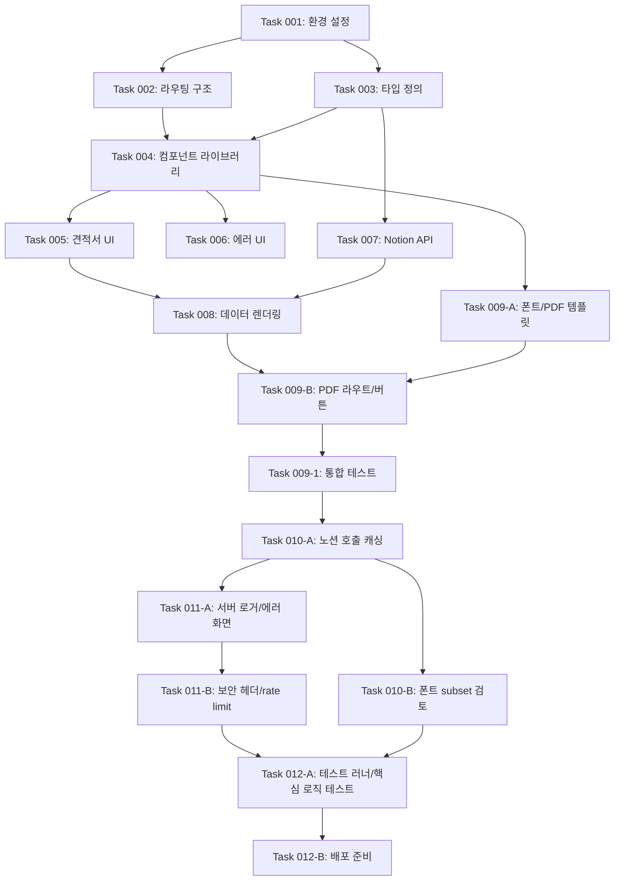

# 노션 기반 견적서 관리 시스템 MVP 개발 로드맵

노션을 데이터베이스로 활용하여 견적서를 관리하고, 클라이언트가 웹에서 조회 및 PDF 다운로드할 수 있는 시스템

## 개요

노션 기반 견적서 관리 시스템 MVP는 프리랜서와 소규모 기업을 위한 간단하고 효율적인 견적서 관리 솔루션으로 다음 기능을 제공합니다:

- **노션 데이터베이스 연동**: Notion API를 통한 실시간 견적서 데이터 조회
- **견적서 웹 조회**: 고유 URL을 통한 견적서 내용 확인
- **PDF 다운로드**: 견적서를 PDF 파일로 변환하여 저장 및 인쇄

## 개발 워크플로우

1. **작업 계획**
   - 기존 코드베이스를 학습하고 현재 상태를 파악
   - 새로운 작업을 포함하도록 `ROADMAP.md` 업데이트
   - 우선순위 작업은 마지막 완료된 작업 다음에 삽입

2. **작업 생성**
   - 기존 코드베이스를 학습하고 현재 상태를 파악
   - `/tasks` 디렉토리에 새 작업 파일 생성
   - 명명 형식: `XXX-description.md` (예: `001-setup.md`)
   - 고수준 명세서, 관련 파일, 수락 기준, 구현 단계 포함
   - 예시를 위해 `/tasks` 디렉토리의 마지막 완료된 작업 참조
   - API/비즈니스 로직 작업 시 "## 테스트 체크리스트" 섹션 필수 포함 (Playwright MCP 테스트 시나리오 작성)

3. **작업 구현**
   - 작업 파일의 명세서를 따름
   - 기능과 기능성 구현
   - API 연동 및 비즈니스 로직 구현 시 Playwright MCP 테스트 필수
   - 구현 완료 후 Playwright MCP를 사용한 E2E 테스트 실행
   - 테스트 통과 확인 후 다음 단계로 진행
   - 각 단계 후 작업 파일 내 단계 진행 상황 업데이트
   - 각 단계 완료 후 중단하고 추가 지시를 기다림

4. **로드맵 업데이트**
   - 로드맵에서 완료된 작업을 ✅로 표시

## 개발 단계

### Phase 1: 애플리케이션 골격 구축 ✅

- **Task 001: 프로젝트 초기 설정 및 환경 구성** ✅ - 완료 ([작업 파일](../tasks/001-project-setup.md))
  - ✅ Next.js 16 프로젝트 기본 구조 검증
  - ✅ 환경 변수 스키마 검증 (`lib/env.ts`, `.env.example`, 3개 변수, `.env.local`은 직접 생성)
  - ✅ TypeScript 및 ESLint 설정 확인
  - ✅ Notion API 연동을 위한 환경 구성

- **Task 002: 라우팅 구조 및 페이지 골격 생성** ✅ - 완료 ([작업 파일](../tasks/002-routing-skeleton.md))
  - ✅ App Router 기반 라우트 구조 구현 (/invoice/[token], 토큰은 노션 페이지 ID)
  - ✅ 견적서 조회 페이지 골격 생성
  - ✅ 로딩(loading), 에러(error), 404(not-found) 화면 생성
  - ✅ 접근 불가 페이지(/unavailable)와 공통 `StatusCard`
  - ✅ 기본 레이아웃 컴포넌트 설정

- **Task 003: 타입 정의 및 데이터 모델 설계** ✅ - 완료 ([작업 파일](../tasks/003-types-and-models.md))
  - ✅ 견적서 도메인 타입 정의 (실제 노션 DB 기준, 부가세 없음)
  - ✅ Notion API 응답 Zod 스키마 정의
  - ✅ PDF 생성 관련 타입 정의
  - ✅ 에러 핸들링 타입 정의 (`InvoiceFetchError`)
  - ✅ 합계 계산 유틸 (`calculateInvoiceTotals`)

### Phase 2: UI/UX 완성 (더미 데이터 활용) ✅

- **Task 004: 공통 컴포넌트 라이브러리 구축** ✅ - 완료 ([작업 파일](../tasks/004-common-components.md))
  - ✅ shadcn/ui 설정 점검 (new-york 스타일) 및 필요한 컴포넌트 추가 (Button, Card, Table, Badge 등)
  - ✅ 노션 CSV 예시 기준 더미 견적서 데이터 작성 (`types/invoice.ts`의 `Invoice`, `InvoiceItem` 타입 준수, 부가세 없음)
  - ✅ 더미 데이터 합계는 `calculateInvoiceTotals`로 계산 (합계 = 항목 금액 합계)
  - ✅ 디자인 시스템 토큰 점검 (색상, 타이포그래피)

- **Task 005: 견적서 조회 페이지 UI 구현** ✅ - 완료 ([작업 파일](../tasks/005-invoice-view-ui.md))
  - ✅ 견적서 헤더 컴포넌트 (견적서 번호, 발행일, 유효기간, 상태 배지: 대기/승인/거절)
  - ✅ 클라이언트 정보 섹션
  - ✅ 견적 항목 테이블 컴포넌트 (항목명, 수량, 단가, 금액)
  - ✅ 합계 요약 섹션 (항목 금액 합계, 부가세 없음)
  - ✅ PDF 다운로드 버튼 UI
  - ✅ 반응형 레이아웃 구현 (모바일/태블릿/데스크톱)

- **Task 006: 에러 및 로딩 상태 UI 구현** ✅ - 완료 ([작업 파일](../tasks/006-error-loading-ui.md))
  - ✅ Phase 1에서 만든 404, 접근 불가(`StatusCard`) 화면 디자인 고도화
  - ✅ 견적서 상세 레이아웃에 맞춘 로딩 스켈레톤 컴포넌트
  - ✅ 에러 메시지 컴포넌트
  - ✅ 빈 상태(Empty state) 컴포넌트 (견적 항목 0건 등)

### Phase 3: 핵심 기능 구현 ✅

- **Task 007: Notion API 통합 구현** ✅ - 완료 ([작업 파일](../tasks/007-notion-api-integration.md))
  - ✅ Notion API 클라이언트 설정 (`@notionhq/client`, 환경변수 3개 사용)
  - ✅ 견적서 데이터 조회 서비스 구현 (노션 페이지 ID 기반 단건 조회)
  - ✅ 견적 항목 데이터 조회 로직 (`NOTION_ITEM_DATABASE_ID` 기준 관계 항목 조회)
  - ✅ 에러 핸들링 및 재시도 로직 (`InvoiceFetchError` 활용)
  - ✅ Zod 스키마 기반 데이터 변환 및 정규화 유틸리티
  - ✅ Playwright MCP를 활용한 조회 플로우 통합 테스트

- **Task 008: 견적서 데이터 페칭 및 렌더링** ✅ - 완료 ([작업 파일](../tasks/008-invoice-data-rendering.md))
  - ✅ Server Component에서 Notion 데이터 페칭
  - ✅ 더미 데이터를 실제 노션 데이터로 교체
  - ✅ 동적 라우팅 파라미터(`/invoice/[token]`, 토큰 = 노션 페이지 ID) 처리
  - ✅ 데이터 유효성 검증 및 존재하지 않는 견적서 처리 (F011)
  - ✅ 노션 데이터 최신 상태 반영 (캐시 없이 항상 최신 조회, 캐싱은 Task 010)
  - ✅ Playwright MCP로 데이터 렌더링 E2E 테스트 (만료 실데이터는 미확인)

- **Task 009: PDF 생성 및 다운로드 기능** ✅ - 완료, 009-A(폰트·템플릿)와 009-B(라우트·버튼)로 분할 ([작업 파일](../tasks/009-pdf-generation.md))
  - ✅ @react-pdf/renderer 설치 및 설정
  - ✅ PDF 템플릿 컴포넌트 개발 (`types/pdf.ts` 타입 활용, 009-A)
  - ✅ Route Handler 구현 (`app/invoice/[token]/pdf/route.ts`, 009-B)
  - ✅ PDF 다운로드 트리거 로직
  - ✅ 한글 폰트 지원 설정 (Noto Sans KR OTF, `assets/fonts`, 009-A)
  - ✅ Playwright MCP로 PDF 생성 플로우 테스트

- **Task 009-1: 핵심 기능 통합 테스트** ✅ - 완료, 일부 시나리오 미확인 ([작업 파일](../tasks/009-1-core-integration-test.md))
  - ✅ Playwright MCP를 사용한 전체 사용자 플로우 테스트
  - ✅ API 연동 및 비즈니스 로직 검증
  - ✅ 에러 핸들링 및 엣지 케이스 테스트 (만료 410, 항목 0건 실데이터는 미확인)
  - ✅ 데이터 무결성 및 일관성 검증 (합계 = 항목 금액 합계)
  - ✅ 성능 및 응답 시간 테스트

### Phase 4: 고급 기능 및 최적화

실행 순서: 010-A → 011-A → 011-B → 010-B → 012-A → 012-B. 결정 사항은 각 작업 파일 상단에 기록했습니다. (2026-11-16)

- **Task 010: 성능 최적화 및 캐싱** ✅ - 완료, 010-A, 010-B로 분할 ([작업 파일](../tasks/010-performance-caching.md))
  - **010-A: 노션 호출 최적화와 캐싱** ✅
    - ✅ `getInvoiceByPageId` 결과(`Invoice`)를 서비스 계층에서 `unstable_cache`로 30초 캐시 (TTL 지난 stale 값은 쓰지 않고 재조회)
    - ✅ 성공 결과만 캐시, not_found / query_failed / validation_failed는 캐시 안 함
    - ✅ 토큰 형식 검증과 만료 판정(`isInvoiceExpired`)은 캐시 밖에서 매 요청 수행
    - ✅ `lib/notion.ts`의 `cache: 'no-store'` 유지
    - ✅ 화면 → PDF 요청 시 노션 호출 4회 → 2회(TTL 안 두 번째 요청 0회), 전후 측정 기록 (노션 값 변경 반영 지연은 미확인)
  - **010-B: 폰트 subset과 렌더링 최적화 검토** ✅
    - ✅ Noto Sans KR OTF 2개(합계 9,460,792B) 측정, subset은 글자 누락 위험으로 **미적용** (PDF에는 이미 사용 글자만 임베드되어 67KB, 이후 PDF 생성 약 0.03s)
    - ✅ React Suspense 경계 검토: `loading.tsx`와 중복이므로 현행 유지
    - ✅ 이미지 최적화: 해당 없음 (`next/image`, `` 사용처와 `public/` 폴더 없음)

- **Task 011: 보안 및 에러 처리 강화** ✅ - 완료, 011-A, 011-B로 분할 ([작업 파일](../tasks/011-security-error-handling.md))
  - **011-A: 서버 로거와 에러 화면** ✅
    - ✅ `lib/logger.ts`(server-only, JSON 한 줄)로 노션 오류 객체 직접 출력 대체 (code, status, stage, 토큰 앞 6자만)
    - ✅ 교체 지점: `lib/invoice-service.ts`의 `logFetchError`와 검증 실패 로그 2곳, PDF 라우트 1곳 (+ 노션 SDK 내부 로거 대체)
    - ✅ `app/global-error.tsx` 추가 (루트 레이아웃 오류 처리, OS 다크 모드)
    - ✅ 404/500 문구 일관화
  - **011-B: 보안 헤더와 rate limiting** ✅
    - ✅ `next.config.ts` `headers()`: `Referrer-Policy: no-referrer`, `X-Content-Type-Options: nosniff`, `X-Frame-Options: DENY`
    - ✅ PDF Route Handler 내부에서 `/invoice/[token]/pdf`만 인메모리 IP 제한 (1분 10회, 429, Retry-After), `proxy.ts`는 공식 문서의 전역 상태 의존 금지 안내로 미사용, 한계 README 명시
    - ✅ CORS: 교차 출처 API가 없으므로 허용 헤더를 추가하지 않는 정책 문서화
    - ✅ API 키 보안 재확인 (응답, 429 본문, 로그에서 키·DB ID 0회)
    - CSP(`frame-ancestors` 포함)와 rate limit 외부 저장소는 도입하지 않음 (후속 과제)

- **Task 012: 테스트 및 배포 준비** - 012-A 완료, 012-B 프리뷰 확인 대기 (사용자 수행 필요), 012-A, 012-B로 분할 ([작업 파일](../tasks/012-testing-deployment.md))
  - **012-A: 테스트 러너 도입과 핵심 로직 테스트** ✅
    - ✅ Vitest 도입 (`server-only` 빈 모듈 별칭, `@` 별칭은 Vite 내장 `resolve.tsconfigPaths`, `check-all`에 포함)
    - ✅ 순수 함수 테스트 (`invoice-calculations`, `notion-parser`, `isInvoiceExpired`, `shareTokenSchema`, `toSafeFileName`)
    - ✅ `getNotionClient` 모킹 기반 `getInvoiceByPageId` 테스트 (항목 0건, 100건 초과 페이지네이션, 다른 DB 페이지, 휴지통, 캐시)
    - ✅ PDF 라우트 상태코드 매핑 테스트 (404 / 410 / 500 / 200 / 429)
    - ✅ Task 009-1 미확인 3건(만료 410, 항목 0건, 100건 초과) 모킹 테스트로 해소 (실데이터 확인 아님)
  - **012-B: 배포 준비** - 로컬 준비 완료, 프리뷰 확인은 사용자 수행 필요
    - ✅ Vercel 배포 설정 점검 (자동 감지, `vercel.json` 불필요, 빌드에 노션 키 불필요)
    - ✅ 환경변수 3개와 환경별 설정 관리 (dev/preview/prod) README 문서화
    - `assets/fonts` 번들 포함: 로컬 파일 추적·standalone 패키지로 확인 ✅, 프리뷰 배포 확인은 사용자 수행 필요
    - Chromium 외 브라우저 PDF 수동 체크리스트: README에 작성, Safari·Firefox·iOS Safari·Android Chrome 미확인 (사용자 수행 필요)
    - ✅ CI(`.github/workflows`)는 만들지 않음 (후속 과제)
    - ROADMAP Phase 4 완료 표시: 프리뷰 확인 후

## 작업별 상세 구현 사항

### Task 001: 프로젝트 초기 설정 및 환경 구성

**예상 소요 시간**: 2-3시간

**구현 내용**:

- `.env.local` 파일에 환경 변수 설정 (비밀값이므로 직접 생성)
  ```env
  NOTION_API_KEY=secret_xxxxxxxxxxxxx
  NOTION_INVOICE_DATABASE_ID=xxxxxxxxxxxxx
  NOTION_ITEM_DATABASE_ID=xxxxxxxxxxxxx
  ```
  (`NOTION_DATABASE_ID`는 폐기된 설계)
- `lib/env.ts`의 환경변수 스키마 검증
- TypeScript 설정 검증 (`tsconfig.json`)
- ESLint 설정 확인

**완료 기준**:

- ✅ 환경 변수 3개가 `lib/env.ts`, `.env.example`, README에서 일치함
- ✅ 모든 의존성이 설치되고 버전이 일치함 (Next.js 16, @notionhq/client 5)
- ✅ 개발 서버가 정상 실행됨 (`npm run dev`)
- ✅ 린트 및 타입 체크 통과
- ✅ Shrimp Task Manager MCP 서버 통합 완료

### Task 002: 라우팅 구조 및 페이지 골격 생성

**예상 소요 시간**: 3-4시간

**구현 내용**:

- `app/invoice/[token]/page.tsx` (토큰 형식 검증, 노션 조회는 Task 007~008에서 구현)
- `app/invoice/[token]/loading.tsx` 스켈레톤
- `app/invoice/[token]/error.tsx` 에러 경계
- `app/not-found.tsx` 커스텀 404 페이지
- `app/unavailable/page.tsx` 접근 불가 안내
- `components/layout/status-card.tsx` 공통 안내 카드

**완료 기준**:

- ✅ 동적 라우팅이 정상 작동함 (/invoice/[token] 구조 구현)
- ✅ 형식이 잘못된 토큰은 /unavailable?reason=invalid로 이동함
- ✅ 404 페이지가 올바르게 표시됨 (커스텀 not-found.tsx 구현)
- ✅ 에러 화면이 에러 원문을 노출하지 않음
- ✅ 모바일, 데스크톱 뷰포트에서 레이아웃이 깨지지 않음

### Task 003: 타입 정의 및 데이터 모델 설계

**예상 소요 시간**: 2-3시간

**구현 내용**:

- `types/invoice.ts` - 견적서 도메인 타입 (`Invoice`, `InvoiceItem`, `InvoiceStatus`, `InvoiceTotals`)
- `types/notion.ts` - Notion API 응답 Zod 스키마
- `types/pdf.ts` - PDF 생성 관련 타입
- `types/invoice-error.ts` - 노션 조회 실패 타입과 접근 불가 사유 변환
- `lib/constants.ts` - 상수 정의
- `lib/invoice-calculations.ts` - 항목 금액과 합계 계산

**설계 결정** (실제 노션 DB 기준):

- 부가세 없음, 합계 = 항목 금액 합계
- 공유토큰 없음, URL 토큰 = 노션 페이지 ID
- 상태는 노션 값(대기/승인/거절) 그대로 사용

**완료 기준**:

- ✅ 모든 데이터 모델이 타입으로 정의됨 (Invoice, InvoiceItem, InvoiceTotals)
- ✅ Notion API 응답이 Zod 스키마로 정의됨 (견적서, 견적 항목 페이지)
- ✅ TypeScript 컴파일 에러가 없음, `any` 사용 없음
- ✅ 항목 금액은 수량 x 단가로 재계산됨 (CSV 예시 합계 60,000,000 일치)

### Task 007: Notion API 통합 구현

**예상 소요 시간**: 4-5시간

**구현 내용**:

- `lib/notion.ts` - Notion 클라이언트 초기화
- `lib/invoice-service.ts` - 견적서 데이터 서비스 (`getInvoiceByPageId`)
- `lib/notion-parser.ts` - Notion 데이터 파싱 유틸리티
- `lib/invoice-access.ts` - 접근 판정 (토큰 형식, 조회, 유효기간)
- API 에러 핸들링 및 재시도 로직
- 데이터 변환 및 검증 로직

**완료 기준**:

- [x] Notion API 연결이 성공함
- [x] 노션 페이지 ID로 견적서 데이터를 정상적으로 조회함
- [x] 데이터가 Zod 스키마 검증 후 도메인 타입으로 변환됨
- [x] 에러 처리가 적절히 구현됨 (`InvoiceFetchError` 사유별 처리)

### Task 009: PDF 생성 및 다운로드 기능

**예상 소요 시간**: 5-6시간

**구현 내용**:

- `components/pdf/invoice-template.tsx` - PDF 템플릿
- `app/invoice/[token]/pdf/route.ts` - PDF 생성 Route Handler
- `lib/pdf/fonts.ts` - 한글 폰트 등록 (`assets/fonts`의 Noto Sans KR)
- 한글 폰트 설정 및 스타일링
- 다운로드 트리거 및 파일명 설정

**완료 기준**:

- [x] PDF가 정상적으로 생성됨
- [x] 한글이 올바르게 표시됨
- [x] 레이아웃이 견적서 형식에 맞음 (합계 = 항목 금액 합계, 부가세 없음)
- [ ] 다운로드가 모든 브라우저에서 작동함 (Chromium만 확인, 그 외 미확인 → Task 012-B 수동 체크리스트)

### Task 010-A: 노션 호출 최적화와 캐싱

**구현 내용**:

- `lib/invoice-service.ts` - `getInvoiceByPageId` 결과를 서비스 계층에서 캐시 (성공 결과만, 키는 페이지 ID)
- `lib/invoice-access.ts` - 토큰 형식 검증과 `isInvoiceExpired`는 캐시 밖에서 매 요청 수행 (변경 없음 원칙)
- `lib/notion.ts` - `cache: 'no-store'` 유지
- 근거: `node_modules/next/dist/docs/01-app/02-guides/caching-without-cache-components.md`, `unstable_cache.md`

**결정**: 캐시 TTL 30초, 캐시 방식 `unstable_cache` (2026-11-16)

**완료 기준**:

- [x] TTL 안에서 화면 → PDF 두 번째 요청은 노션을 호출하지 않음
- [x] 조회 실패는 캐시되지 않음
- [x] 만료 판정은 매 요청 KST 오늘 기준 (코드 구조로 확인, 실데이터 만료는 012-A 테스트)
- [x] 전후 노션 호출 횟수와 응답 시간 기록

### Task 011-A: 서버 로거와 에러 화면

**구현 내용**:

- `lib/logger.ts` - 서버 전용 로거 (code, status, stage, 토큰 일부만 기록)
- `lib/invoice-service.ts`, `app/invoice/[token]/pdf/route.ts` - 로그 교체 4곳
- `app/global-error.tsx` - 자체 `<html>`, `<body>`를 갖는 전역 에러 UI (`'use client'`, `retry`)
- 404/500 문구 일관화 (`app/not-found.tsx`, `app/invoice/[token]/error.tsx`, `app/unavailable/page.tsx`, PDF 응답 본문)
- 근거: `node_modules/next/dist/docs/01-app/03-api-reference/03-file-conventions/error.md`

**완료 기준**:

- [x] 서버 로그에 오류 객체 원문, 키, DB ID, 전체 토큰이 없음
- [x] 루트 레이아웃 오류 시 `global-error` 화면이 오류 원문 없이 표시됨
- [x] 404/500 문구가 화면과 PDF 응답에서 일관됨

### Task 011-B: 보안 헤더와 rate limiting

**구현 내용**:

- `next.config.ts` - `headers()`로 Referrer-Policy, X-Content-Type-Options, 프레이밍 차단
- `lib/rate-limit.ts`, `app/invoice/[token]/pdf/route.ts` - PDF 경로 인메모리 IP 제한 (429, Retry-After)
- CORS 허용 헤더 미추가 정책 문서화
- 근거: `proxy.md`(Proxy는 전역 상태에 의존하지 말 것, 기본 Node.js 런타임), `content-security-policy.md`, `headers.md`

**결정**: CSP 미도입, 외부 저장소 미도입, 구현 위치 Route Handler, IP당 1분 10회 (2026-11-16)

**완료 기준**:

- [x] 모든 응답에 보안 헤더 포함
- [x] PDF 경로 제한 초과 시 429 + Retry-After
- [x] 인메모리 제한의 한계와 CORS 정책 문서화

### Task 010-B: 폰트 subset과 렌더링 최적화 검토

**구현 내용**:

- `assets/fonts/`, `lib/pdf/fonts.ts` - subset 적용 시에만 변경 (KS X 1001 2350자 + 영문·숫자·기호, 일회성 스크립트, npm 의존성 추가 금지)
- Suspense 경계 검토: `app/invoice/[token]/loading.tsx`와 중복이면 현행 유지
- 이미지 최적화: 해당 없음 (`next/image`, `` 사용처와 `public/` 폴더 없음)

**결정**: 폰트 subset 미적용 (측정만, 2026-11-16)

**완료 기준**:

- [x] subset 적용 여부 결정과 사유 기록
- [ ] (적용 시) PDF 한글·숫자·기호 누락 없음, 크기와 생성 시간 전후 비교 — 해당 없음 (미적용)
- [x] Suspense 검토 결론 기록

### Task 012-A: 테스트 러너 도입과 핵심 로직 테스트

**구현 내용**:

- `vitest.config.mts` - `environment: 'node'`, `vite-tsconfig-paths`로 `@` 별칭, `server-only` 빈 모듈 별칭
- 순수 함수, `getInvoiceByPageId`(노션 클라이언트 모킹), `getAccessibleInvoice`, PDF 라우트 `GET` 테스트
- `toSafeFileName`을 PDF 라우트에서 `lib/`로 분리 (현재 비공개 함수)
- 근거: `node_modules/next/dist/docs/01-app/02-guides/testing/vitest.md` (async Server Component는 Vitest 미지원, E2E 권장)

**결정**: Vitest 도입 승인, `test`를 `check-all`에 포함 (2026-11-16)

**완료 기준**:

- [x] `npm run test`가 노션 키 없이 통과 (55개)
- [x] 만료 410, 항목 0건, 100건 초과 페이지네이션이 테스트로 확인됨 (모킹)
- [x] PDF 라우트 404 / 410 / 500 / 200 매핑 확인

### Task 012-B: 배포 준비

**구현 내용**:

- Vercel 프로젝트 설정, 환경변수 3개(Development / Preview / Production) 문서화
- 프리뷰 배포에서 `assets/fonts` 포함 확인, 누락 시 `next.config.ts`의 `outputFileTracingIncludes`
- 프리뷰 배포에서 010-A 캐시, 011-B 헤더와 rate limit 확인
- Chromium 외 브라우저 PDF 수동 체크리스트
- (승인 시) `.github/workflows/ci.yml`

**결정**: CI 미포함(후속 과제), 배포 대상 Vercel (2026-11-16)

**완료 기준**:

- [ ] 프리뷰 배포에서 화면과 한글 PDF 정상 (사용자 수행 필요, 로컬 standalone으로는 확인)
- [x] 환경변수와 배포 절차가 README에 문서화됨
- [ ] 브라우저 수동 체크리스트 결과 기록 (Chromium 외 미확인)
- [ ] ROADMAP Phase 4 완료 표시

## 기술적 의존성 관계



- 010-B는 010-A에만 의존하고 011과는 독립이라 실행 순서를 바꿀 수 있습니다. 기본 순서는 011-B 다음입니다.
- 012-A는 010-A의 캐시 래핑과 011-A의 로거가 반영된 코드를 테스트하므로 그 뒤에 둡니다.

## MVP 체크리스트

### 핵심 기능 구현 확인

- [x] **F001**: Notion API를 통한 견적서 데이터 조회
- [x] **F002**: 고유 URL로 특정 견적서 내용 표시
- [x] **F003**: 견적서를 PDF 파일로 변환 및 다운로드

### 필수 지원 기능 구현 확인

- [x] **F010**: 노션 페이지 ID 기반 고유 URL (`/invoice/[token]`) - 토큰 형식 검증과 실제 노션 조회 연동 완료 (유효기간 만료 판정은 Task 012-A 테스트로 확인, 실데이터 만료 화면 이동은 미확인)
- [x] **F011**: 존재하지 않는 견적서 접근 시 에러 처리
- [x] **F012**: 반응형 레이아웃 (모바일/태블릿/데스크톱)

### 품질 검증

- [x] 모든 페이지가 정상적으로 로드됨
- [x] Notion 데이터 변경이 웹 화면에 반영됨 (유효기간 변경 전후 화면 변화로 확인, 별도 통제 실험은 아님)
- [ ] PDF 다운로드가 모든 환경에서 작동함 (Chromium만 확인 → Task 012-B 브라우저 수동 체크리스트, 프리뷰 배포 확인)
- [x] 에러 처리가 사용자 친화적임
- [x] 반응형 디자인이 모든 기기에서 작동함 (375/768/1280px 확인, 실기기 미확인)

### 테스트 검증

- [x] API 연동 및 비즈니스 로직에 Playwright MCP 테스트 수행되었는가?
- [ ] 모든 사용자 플로우가 E2E 테스트되었는가? (만료, 항목 0건 실데이터 플로우 미확인 → Task 012-A 모킹 테스트, 012-B 프리뷰 배포 회귀)
- [x] 에러 핸들링 및 엣지 케이스가 테스트되었는가? (만료 410, 항목 0건, 100건 초과를 Task 012-A Vitest 모킹 테스트로 확인, 실데이터 아님)

## 예상 개발 일정

**총 예상 기간**: 2-3주 (1인 개발 기준)

- **Week 1**: Phase 1 ✅ + Phase 2 ✅ (Task 001-006)
  - ✅ 프로젝트 설정 완료 (Task 001-003 완료)
  - ✅ UI 구현 (Task 004-006 완료)
  - ✅ 더미 데이터로 전체 플로우 검증

- **Week 2**: Phase 3 ✅ (Task 007-009-1)
  - ✅ Notion API 통합 (Task 007)
  - ✅ 실제 데이터 연동 (Task 008)
  - ✅ PDF 생성 기능 구현 (Task 009-A, 009-B)
  - ✅ 통합 테스트 및 검증 (Task 009-1)

- **Week 3**: Phase 4 (Task 010-A ~ 012-B)
  - 노션 호출 캐싱 (Task 010-A)
  - 서버 로거, 에러 화면, 보안 헤더, rate limiting (Task 011-A, 011-B)
  - 폰트 subset 검토 (Task 010-B)
  - 테스트 러너 도입과 핵심 로직 테스트 (Task 012-A)
  - 배포 준비 및 실제 배포 (Task 012-B)

## 위험 요소 및 대응 방안

### 기술적 위험

1. **Notion API 제한**
   - Rate limit 초과 가능성
   - 대응: 캐싱 전략 구현, 요청 최적화 (Task 010-A), PDF 경로 rate limiting (Task 011-B)

2. **PDF 한글 렌더링 문제**
   - 폰트 임베딩 이슈
   - 대응: 사전 테스트, 대체 라이브러리 준비

3. **대용량 견적서 처리**
   - 많은 항목 시 성능 저하
   - 대응: 페이지네이션, 가상 스크롤링

### 비즈니스 위험

1. **사용자 경험 저하**
   - 느린 로딩 속도
   - 대응: 스켈레톤 UI, 점진적 로딩

2. **보안 이슈**
   - API 키 노출
   - 대응: 서버 사이드 처리, 환경 변수 관리

## 성공 지표

- **기술적 지표**
  - 페이지 로드 시간 < 3초
  - PDF 생성 시간 < 5초
  - 에러율 < 1%

- **사용자 경험 지표**
  - 모바일 반응형 100% 지원
  - 크로스 브라우저 호환성 100%
  - 견적서 조회 성공률 > 99%

---

**📝 문서 버전**: v2.0
**📅 작성일**: 2026-11-11
**📅 최종 업데이트**: 2026-11-16
**🎯 목표**: MVP 핵심 기능 구현을 통한 빠른 시장 검증
**📊 진행 상황**: Phase 1~3 완료 (Task 001~009-1), Phase 4는 010-A, 011-A, 011-B, 010-B, 012-A 완료, 012-B는 로컬 준비까지 완료하고 Vercel 프리뷰 확인과 브라우저 수동 체크(사용자 수행 필요)가 남음
